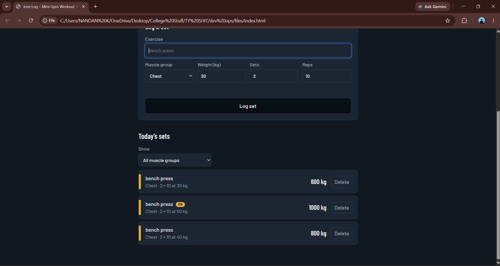
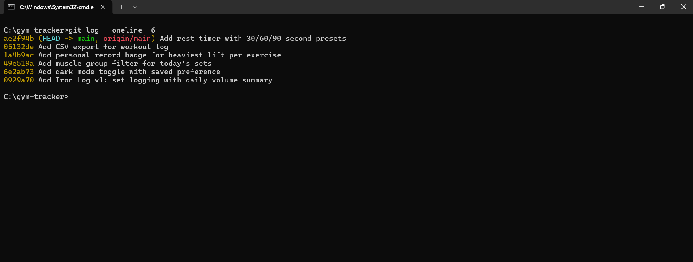
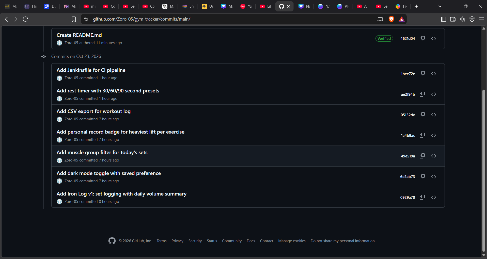
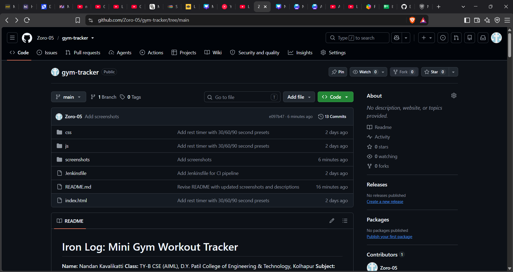
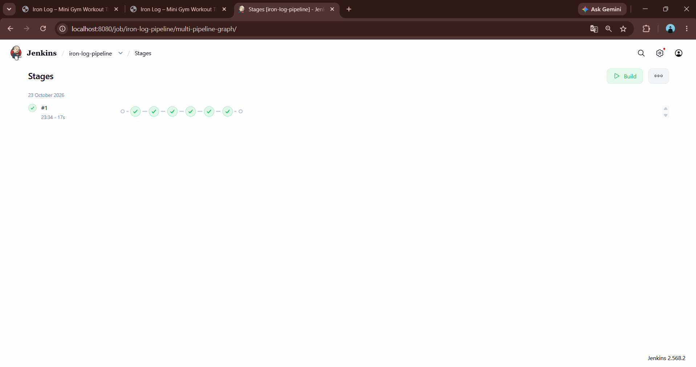

# Iron Log: Mini Gym Workout Tracker

**Name:** Nandan Kavalikatti
**Class:** TY-B CSE (AIML), D.Y. Patil College of Engineering & Technology, Kolhapur
**Subject:** DevOps and Kubernetes (ISE-II)
**Repository:** https://github.com/Zoro-05/gym-tracker

---

## 1. Introduction and Objective

Iron Log is a small gym workout tracker that runs fully in the browser. You log each set (exercise, muscle group, weight, sets, reps) and the app shows your **total training volume for today** (weight x sets x reps) in a colour-split bar, with one colour per muscle group (like gym weight plates).

**Objective:**
- Build a unique website.
- Use Git and GitHub with 5+ meaningful changes pushed with commit history.
- Integrate a DevOps tool (Jenkins) with a CI pipeline on the GitHub repository.
- Document everything with screenshots.

## 2. Technology Stack

| Part | Technology |
|---|---|
| Frontend | HTML5, CSS3, vanilla JavaScript (no framework, no build step) |
| Storage | Browser localStorage |
| Fonts | Barlow, Barlow Condensed (Google Fonts) |
| Version control | Git, GitHub |
| DevOps tool | Jenkins 2.568.2 (Pipeline with Jenkinsfile) |
| Editor | Antigravity (AI IDE) |
| OS | Windows, cmd terminal |

## 3. Project Structure

```
gym-tracker/
├── index.html        # page structure
├── css/
│   └── style.css     # styling (dark and light themes)
├── js/
│   └── script.js     # app logic
├── Jenkinsfile       # Jenkins pipeline definition
├── screenshots/      # proof images used in this README
└── README.md
```

## 4. How to Run the Website

No installation needed.

1. Clone the repo:
   ```
   git clone https://github.com/Zoro-05/gym-tracker.git
   ```
2. Open the folder `gym-tracker`.
3. Double-click `index.html` to open it in any browser.

Data is saved in the browser (localStorage), so nothing is sent anywhere.

### Features
- Log a set with exercise, muscle group, weight, sets and reps
- Total volume today with colour-split bar and legend
- Delete a set
- Dark / light mode toggle (saved)
- Filter today's sets by muscle group
- Personal record (PR) badge
- Export workout log as CSV
- Rest timer (30 / 60 / 90 seconds)


*Iron Log running locally: dark mode, muscle group filter and PR badge*

## 5. Git and GitHub Workflow

### 5.1 Initial setup and first push

```
cd C:\gym-tracker
git init
git add .
git commit -m "Add Iron Log v1: set logging with daily volume summary"
git branch -M main
git remote add origin https://github.com/Zoro-05/gym-tracker.git
git push -u origin main
```

### 5.2 Workflow used for every change

Each change was made one at a time, tested in the browser, then committed and pushed:

```
git status
git add .
git commit -m "<meaningful message>"
git push
git log --oneline
```

### 5.3 Commit history

| # | Commit | Message |
|---|---|---|
| Initial | `0929a70` | Add Iron Log v1: set logging with daily volume summary |
| 1 | `6e2ab73` | Add dark mode toggle with saved preference |
| 2 | `49e519a` | Add muscle group filter for today's sets |
| 3 | `1a4b9ac` | Add personal record badge for heaviest lift per exercise |
| 4 | `05132de` | Add CSV export for workout log |
| 5 | `ae2f94b` | Add rest timer with 30/60/90 second presets |
| DevOps | `1bee72e` | Add Jenkinsfile for CI pipeline |


*git log --oneline: initial commit plus 5 changes*


*Commit history on GitHub*


*GitHub repository with project files and README*

## 6. Changes Made (5 changes)

### Change 1: Dark mode toggle
**Commit:** `6e2ab73`: Add dark mode toggle with saved preference
A header button switches between dark and light themes. The choice is saved in localStorage so it stays after refresh. (Visible in the website screenshot in section 4.)

### Change 2: Filter by muscle group
**Commit:** `49e519a`: Add muscle group filter for today's sets
A dropdown above the list shows only the sets of the selected muscle group (or all). (Visible in the website screenshot in section 4.)

### Change 3: Personal record badge
**Commit:** `1a4b9ac`: Add personal record badge for heaviest lift per exercise
A "PR" badge appears on the set with the heaviest weight for each exercise. (Visible in the website screenshot in section 4.)

### Change 4: Export CSV
**Commit:** `05132de`: Add CSV export for workout log
An "Export CSV" button below the list downloads all logged sets as a CSV file. The button is disabled when there are no entries.

### Change 5: Rest timer
**Commit:** `ae2f94b`: Add rest timer with 30/60/90 second presets
A rest timer between the form and the list, with 30s / 60s / 90s presets and a Reset button. It shows time as mm:ss, turns red and pulses under 10 seconds, shows "Rest over" with a short beep at 0, and only one timer runs at a time.

## 7. DevOps Tool Integration: Jenkins

Jenkins builds a CI pipeline that pulls the project from GitHub and checks it on every build.

### Step 1: Jenkins running
Jenkins 2.568.2 is installed on the local Windows machine and runs at `http://localhost:8080`. The Git and Pipeline plugins are installed.

### Step 2: Create the Jenkinsfile
A `Jenkinsfile` was added to the root of the repository. It defines 4 stages:

| Stage | What it does |
|---|---|
| Checkout | Pulls the source code from GitHub |
| Verify project files | Checks `index.html`, `css/style.css` and `js/script.js` exist |
| Check features present | Checks the Export CSV button and rest timer are in `index.html` |
| Archive site | Saves the site files as build artifacts |

It was committed and pushed with Git:

```
git add .
git commit -m "Add Jenkinsfile for CI pipeline"
git push
```

### Step 3: Create the Jenkins job
1. Jenkins dashboard, **New Item**.
2. Name: `iron-log-pipeline`, type **Pipeline**, click OK.
3. Under **Pipeline**, Definition: **Pipeline script from SCM**.
4. SCM: **Git**.
5. Repository URL: `https://github.com/Zoro-05/gym-tracker.git`
6. Branch Specifier: `*/main`
7. Script Path: `Jenkinsfile`
8. Save.

### Step 4: Run the build
Clicked **Build Now**. Build #1 completed successfully in 17 seconds, and the site files (`index.html`, `style.css`, `script.js`) were archived as artifacts.


*Jenkins build #1 successful, site files archived as artifacts*

## 8. Conclusion

The Iron Log website was built with plain HTML, CSS and JavaScript, improved through 5 meaningful changes tracked with Git and GitHub, and verified automatically with a Jenkins CI pipeline.
